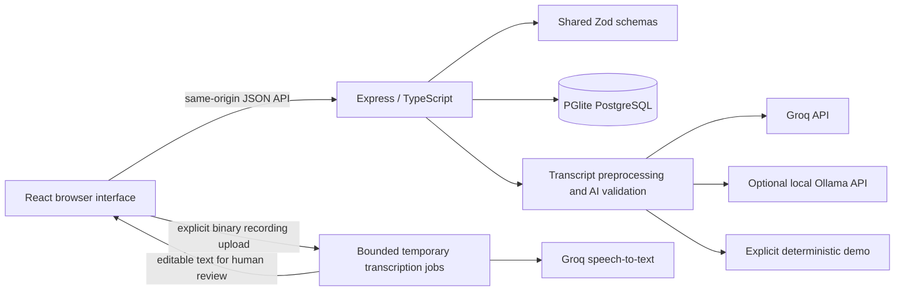

# Architecture

## System shape

The application implements the stack in slide 7 with one browser frontend and one local Node.js process. TypeScript and shared Zod schemas keep request and AI output contracts consistent. PGlite runs PostgreSQL in the server process and persists to a configurable directory.

## Boundaries

| Layer | Responsibility |
| --- | --- |
| Frontend | Project/meeting navigation, text import, search, task updates, draft editing, confirmation, provider selection and visible errors |
| API | Request validation, meeting lifecycle, database access, version conflicts, bounded analysis jobs and safe errors |
| Database | Durable projects, source transcripts, meeting records, action items, settings and job state |
| AI layer | Provider discovery, transcript normalization/chunking, structured generation, parsing/validation and factual-evidence checks |
| Speech input | Binary upload validation, fixed Groq speech endpoint, bounded temporary jobs, explicit cancellation, duplicate protection, editable transcript handoff |
| Shared contract | Provider enum, input limits, dates, meeting records, action items, job/status and settings types |

The frontend never receives the Groq key. Only the backend reads credentials. Provider/model configuration is separate from transcript data.

## Data lifecycle

1. A project provides a container for related meetings.
2. The meeting input saves title, date, participants and the source transcript as a draft.
3. An analysis job uses the selected provider. The UI polls progress while preserving the saved meeting.
4. Validated output becomes an editable review draft. It includes provider/model provenance and warnings. Demo results remain labelled.
5. Confirmation saves the reviewed record and creates its follow-up items in one transaction.
6. Follow-up edits update their own status/owner/deadline/priority fields. A version token detects stale writes.

The original transcript remains separate from generated/reviewed content. Each meeting owns its own record and analysis job. A service failure cannot replace the source with a partial result. Jobs interrupted by a server restart must be recoverable rather than appearing to process forever.

The later audio extension runs before step 2: upload recording, transcribe through Groq, edit the recognized text, explicitly use the reviewed transcript, then save a meeting. Its transient jobs are held in memory (one active, ten retained, thirty-minute expiry); a missing job after restart produces an actionable re-upload message. Raw audio is not stored in PostgreSQL or written to disk. This differs deliberately from persistent meeting-analysis jobs. See [audio-transcription.md](audio-transcription.md) for retention and service boundaries.

Edits made in the review form are saved when the user confirms the record; navigating away before confirmation can discard those unsaved edits. The confirmed record is a historical snapshot. Later follow-up edits live in the action-item table and do not rewrite that snapshot. Changing the original transcript invalidates its generated record and follow-up items, so the user must analyze and review the changed source again.

## AI contract and trust

Both Groq and Ollama produce the same `MeetingRecord` structure: summary, decisions, action items, blockers, and questions. Action owners/deadlines are nullable. Structured entries include verbatim evidence from the transcript. Unknown keys, unexpected structures, missing required fields, oversized output, and malformed JSON fail validation before storage.

Text is normalized and split into bounded chunks when needed. Chunk results are combined without treating them as new source facts. Evidence validation can reject unsupported quotations and ownership/date claims; it cannot prove that every natural-language summary or decision is semantically correct. The review step is the final control against model mistakes.

The provider selection is explicit. Groq is preferred when configured, and model availability is discovered rather than assumed. Ollama status checks distinguish unreachable server and missing model. Temporary Groq failure may offer an available local provider, but a switch requires a visible user choice. The application avoids unbounded retries and unexpected quota consumption. Demo mode is deterministic, extractive, and clearly identified.

## Deployment and security decisions

- The server listens on `127.0.0.1`. Vite development mode proxies API requests to that local server; production serves the built frontend from the backend.
- There are no accounts or tenant boundaries. This is a local personal workspace. Do not expose it to a LAN or public internet without adding authentication, authorization and HTTPS.
- Mutation requests require their expected content type and trusted local origin. The dedicated transcription endpoint accepts bounded `application/octet-stream` uploads before the JSON parser; normal resources use JSON. Parameterized SQL prevents input from becoming SQL syntax. React renders transcript/model text without raw HTML execution.
- Shared schemas enforce field limits, UUIDs, valid calendar dates and enums. Error responses use safe descriptions rather than stack traces or API secrets.
- Environment secrets and runtime data are ignored by Git. A blank `.env.example` documents the configuration. Model output and transcripts should not be logged.
- The database contains unencrypted meeting content. Protect the computer account and backups. Cloud analysis sends the chosen transcript to Groq; selecting Ollama keeps summary inference on the configured local service. Optional speech transcription always sends the explicitly shared recording to Groq, regardless of the later summary provider.
- Ollama's base URL is backend configuration, not arbitrary browser-controlled routing. A model is pulled only through an explained setup action, not a hidden frontend side effect.

## Persistence and operations

The data directory is configurable with `DATA_DIR`. Production/local data and automated-test data must use different directories. API tests create isolated databases. Browser tests launch an isolated server/database with explicit demo mode and never remove user records.

One application process owns a PGlite directory. Running two processes against the same directory is unsupported. Back up a closed database directory to obtain a consistent local backup. Moving to hosted PostgreSQL is an operational migration, not an authentication solution.

See the README for exact Windows startup commands and environment fields. See the test report for executed checks, provider/model inference outcomes, and remaining limitations.
